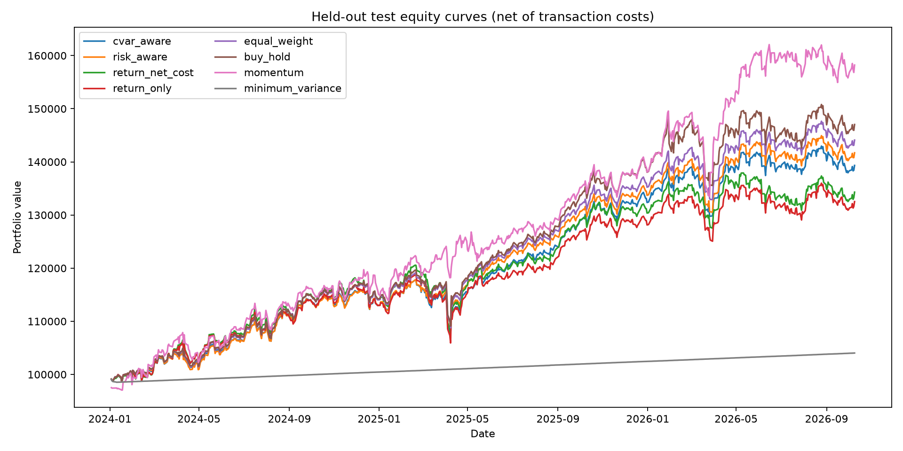

# Risk-Aware RL Portfolio Management

Educational research code for locally trained PPO allocation across SPY, QQQ, GLD, IEF, VNQ, and synthetic cash. The project includes an adjusted-price data pipeline, causal features, a Gymnasium portfolio environment, configurable rewards, PPO training, conventional benchmarks, cost-aware held-out backtesting, FastAPI, and Streamlit. It is not a live-trading system and does not provide investment advice.

See the [project demonstration and experimental report](docs/project_demonstration_report.md) for the system walkthrough, evaluation protocol, measured results, and limitations.

## Setup (Windows PowerShell)

Use Python 3.11–3.13. From the project root:

```powershell
python -m venv .venv
.\.venv\Scripts\Activate.ps1
python -m pip install --upgrade pip
python -m pip install -r requirements.txt
python scripts\verify_environment.py
```

If activation is blocked in this PowerShell process, run `Set-ExecutionPolicy -Scope Process -ExecutionPolicy Bypass`, then activate. `deactivate` exits the environment.

## Data and experiments

```powershell
# Download if not cached; writes data/processed/*.csv and provenance manifest
python -m src.data.pipeline
# Force a fresh provider request
python -m src.data.pipeline --refresh
# Train one reward variant or the four comparable variants
python -m src.training.train --timesteps 100000 --reward risk_aware
python -m src.training.train --timesteps 100000 --reward cvar_aware
python -m src.training.train --reward all
# Generate held-out test comparisons after freezing methodology
python -m src.evaluation.run_evaluation
```

Project date boundaries are inclusive. yfinance's `end` parameter is exclusive; with a dynamic latest-date setting, the downloader excludes the current session before the close and advances the bound after the close buffer. Prices use yfinance `Close` with `auto_adjust=True`; the same data is not adjusted again. See [docs/project_overview.md](docs/project_overview.md) and [docs/evaluation.md](docs/evaluation.md).

## API and dashboard

Start the backend and dashboard in separate activated terminals from the project root:

```powershell
uvicorn api.main:app --reload
streamlit run streamlit/app.py
```

API OpenAPI docs: `http://127.0.0.1:8000/docs`. The dashboard calls the API at `http://127.0.0.1:8000`; set `PORTFOLIO_API_URL` to override. Set `PORTFOLIO_MODEL_PATH` to load a different model artifact. If the model is unavailable, health reports `model_ready: false`, and prediction endpoints return a useful error.

### Streamlit Community Cloud

The app can be deployed from the GitHub repository without a separate server. In Streamlit Community Cloud, create an app from `vKrish14/Risk-Aware-RL-Portfolio`, branch `main`, and entrypoint `streamlit/app.py`; select Python 3.11 in the app's advanced settings. The repository includes the compact trained policy, preprocessing metadata, saved market splits, and evaluation report needed by the dashboard. No API token is required. The app starts its local FastAPI service when an interactive API-backed feature is first used.

The dashboard includes a saved-results strategy comparison and a **What-if portfolio simulator**. Upload daily simple returns as decimal values in a CSV with columns `date,SPY,QQQ,GLD,IEF,VNQ,CASH`, choose target weights and assumptions, then run a cost-aware scenario. The simulator and saved-report pages work without a trained checkpoint; PPO inference still requires the model and preprocessing artifacts.

### Dashboard guide

- **Project map · Start here:** inspect the complete data-to-dashboard path and choose a stage to learn more.
- **Project at a glance:** research question, saved headline results, and metric definitions.
- **How the strategy learns:** plain-language RL/PPO guide, technology roles, portfolio equations, and validation process.
- **Finance quick reference:** searchable abbreviation glossary and compound-growth calculators.
- **Market explorer:** search companies or tickers, view provider-reported quotes, and chart selected tickers over an inclusive date range with candle patterns.
- **Portfolio performance:** choose a strategy and date window, then review equity, allocations, and metrics.
- **Strategy scorecard:** rank strategies by a selected metric and export the comparison as CSV.
- **Model research:** inspect PPO reward variants and the cost/risk trade-offs.
- **Allocation lab:** enter current portfolio weights and state, then request target weights for the latest locally cached feature date.
- **Experimental tail-risk PPO:** an additional policy input/reward uses the average loss in the worst 5% of its latest 60 daily returns and a 2% daily loss budget. It is a project experiment, not an established or proven improvement.
- **What-if simulator:** upload daily simple-return data, choose portfolio weights and cost assumptions, and download the simulated path. Use the synthetic sample to try it without external data.

Metric labels include help text in the interface. Sharpe and Sortino use a 2% annual risk-free assumption; annualization uses 252 daily periods. The app distinguishes saved historical results from a hypothetical PPO allocation and does not place trades.

## Tests

```powershell
python -m pytest -q
```

## Observed results

The saved 2024–2026 held-out experiment did not show PPO outperforming all baselines: standard risk-aware PPO Sharpe was 1.19 versus 1.26 equal weight, 1.21 buy-and-hold, and 1.32 momentum. The experimental CVaR-aware variant had a 1.15 Sharpe and slightly lower measured 95% daily tail loss than standard risk-aware PPO, but also lower return and a worse drawdown. See [the measured results and limitations](docs/experimental_results.md), the machine-readable [test report](results/backtests/test_report.json), and generated plots in `results/figures/`. These are actual results from the local cached data, not a performance promise.



The four notebooks under `notebooks/` can be opened in JupyterLab (install it with `python -m pip install jupyterlab` if needed). They inspect cached data, causal features, a seeded environment episode, and generated evaluation output.

## Configuration and conventions

- Assets: SPY, QQQ, GLD, IEF, VNQ, CASH. Initial capital: $100,000; seed: 42.
- Long-only weights, no leverage, daily rebalance decisions.
- Cost: 0.1% × half-L1 change in target weights (one-way turnover).
- Synthetic cash return: configurable 2% annual, converted with 252 sessions.
- PPO starts with MlpPolicy, learning rate 0.0003, gamma 0.99, GAE lambda 0.95, clip 0.2, batch 64, 2048 rollout steps, entropy coefficient 0.01, value coefficient 0.5, CPU.
- Baselines and the agent share the same eligible dates and cost-aware backtester. Test data is held out from checkpoint selection.

See [the reference-source notes](docs/reference_repositories.md) for architecture inspiration and code-reuse records.

Project-authored code is under the [MIT License](LICENSE). No third-party implementation code was copied.
