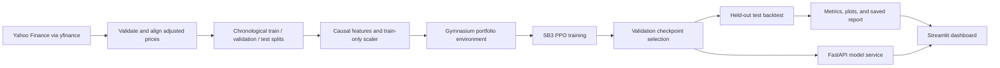
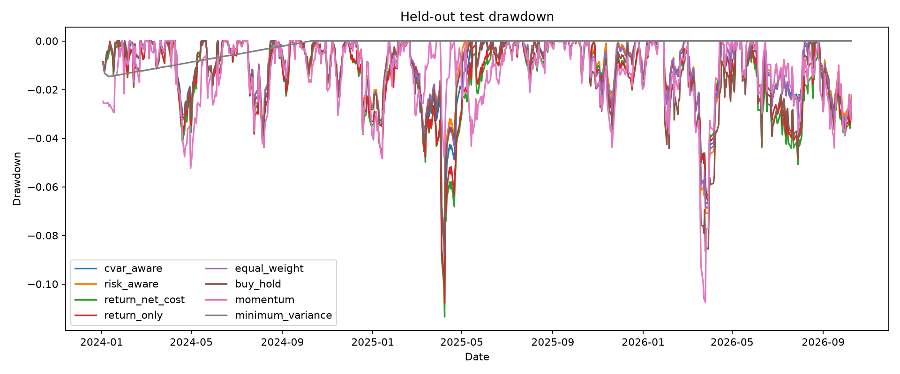

# Risk-Aware RL Portfolio Management

## Project Demonstration and Experimental Report

**Report date:** 10 October 2026
**Project type:** Educational, locally trained reinforcement-learning research system
**Primary question:** Can a risk-aware Proximal Policy Optimization (PPO) policy allocate dynamically across a small multi-asset universe with competitive risk-adjusted performance after modeled transaction costs?

> **Scope notice:** This is a research and software demonstration. It is not a live-trading service, a return forecast, or investment advice. Historical results do not imply future performance.

## Executive summary

This project implements a reproducible pipeline for downloading and preparing adjusted daily prices, engineering causal features, training a PPO portfolio policy, comparing that policy with conventional allocation strategies, and serving the saved policy through a local API and dashboard.

The experiment covers SPY, QQQ, GLD, IEF, and VNQ, plus a configurable synthetic cash asset. The evaluated policy is long-only, unlevered, and constrained to fully allocated portfolio weights. The training and checkpoint-selection periods are chronological; the final comparison uses the held-out period from **2 January 2024 through 9 October 2026**. PPO checkpoints are selected using validation data, not test performance.

The results are mixed. Risk-aware PPO returned **41.71%** over the test period, with a **1.19 Sharpe ratio**, **−8.64% maximum drawdown**, and **$2,448** in modeled transaction costs. Equal weight, buy-and-hold, and momentum produced higher total returns; those three also had higher Sharpe ratios than risk-aware PPO. The risk-aware reward variant traded much less than the two return-oriented PPO variants. This single seed and single test window do not establish that the policy is robust or investable.

The software demonstration includes a data pipeline, feature preprocessing, Gymnasium environment, PPO training and evaluation, four baseline families, FastAPI endpoints, and an interactive Streamlit dashboard. This iteration adds a beginner guide, interactive adjusted-price candlesticks, and an experimental tail-risk PPO state/reward. The updated test run passed **31 tests**, including two for the new tail-risk reward/state. Current syntax/whitespace checks and held-out evaluation completed successfully.

## 1. Research objective and scope

The research question is:

> Can a risk-aware PPO agent learn a dynamic portfolio allocation policy that achieves competitive risk-adjusted performance while controlling drawdown and transaction costs?

The project is designed to make the full workflow inspectable rather than to present a policy as an investment product. The implementation deliberately records its price convention, date splits, turnover definition, cash assumption, reward variants, validation checkpoint selection, and held-out metrics. The data provider is Yahoo Finance through `yfinance`; provider history may be corrected or become unavailable, so exact replication requires retaining the downloaded price snapshot and its provenance manifest.

### Included assets and constraints

| Symbol | Role |
|---|---|
| SPY | U.S. large-cap equity exposure |
| QQQ | Nasdaq-100 equity exposure |
| GLD | Gold exposure |
| IEF | Intermediate-term U.S. Treasury exposure |
| VNQ | U.S. real-estate exposure |
| CASH | Synthetic cash return |

Initial capital is **$100,000**. Portfolio weights are nonnegative and sum to one across all six allocations. Short selling and leverage are excluded. Cash earns a configurable **2% annual synthetic return** converted using 252 sessions. This is a modeling assumption, not a historical cash series.

## 2. System design

The program is organized as a sequence of separable stages:



### Data and feature preparation

Daily prices are requested with `auto_adjust=True`; the returned `Close` field is used once as an adjusted-price series, avoiding a second adjustment. Observations are checked for duplicate dates, nonpositive or infinite values, and missing values. Common complete dates are aligned across the risky assets; missing values are not filled from future observations. The configured train, validation, and test windows are chronological and use inclusive boundaries. Yahoo Finance's `end` argument is exclusive, which is handled by the downloader.

Features include one-, five-, and twenty-session returns; twenty- and sixty-session momentum; rolling volatility; RSI; MACD and its signal; and short and long moving averages. Rolling warm-up rows are handled consistently. The scaler is fitted on training rows only and reused for validation, testing, and inference. The policy's state combines these features with current portfolio weights, NAV relative to initial capital, prior net return, drawdown, and trailing portfolio volatility.

### MDP and portfolio accounting

The action is a vector of six bounded logits. A softmax transformation produces nonnegative target weights that sum to one. At decision date *t*, the policy sees market information through *t*, chooses target weights, pays a transaction cost, and then receives the next close-to-close asset returns.

One-way turnover is defined as:

`turnover[t] = 0.5 × sum(abs(target_weights[t] − drifted_weights[t]))`

The modeled cost fraction is `0.001 × turnover`. Portfolio value is reduced by this cost before the target allocation earns the next-period return. Holdings then drift with realized returns before the next rebalance decision. The environment uses fractional shares and does not simulate execution lots.

The cost model does not include bid-ask spreads, slippage, taxes, liquidity constraints, market impact, or failed orders. These exclusions limit how closely the backtest represents real execution.

### Reward variants and PPO setup

Four reward objectives are now available under comparable PPO settings:

1. **Return only:** gross next-period portfolio return.
2. **Return net of cost:** realized portfolio return after the modeled trading cost.
3. **Risk aware:** gross return less configurable transaction-cost, trailing-volatility, and drawdown penalties.
4. **Experimental CVaR aware:** adds rolling 60-day CVaR at 95% to the state and penalizes reward when the average loss in the worst 5% of daily returns exceeds a 2% daily budget.

The PPO starting configuration uses `MlpPolicy`, learning rate **0.0003**, discount **0.99**, GAE lambda **0.95**, clip range **0.2**, batch size **64**, rollout length **2,048**, entropy coefficient **0.01**, value coefficient **0.5**, CPU execution, and seed **42**. The requested budget was 100,000 timesteps per variant. Stable-Baselines3 completed **100,352 timesteps** per run because learning advances in complete 2,048-step rollouts.

Best checkpoints were selected deterministically on validation reward. Test-period outcomes were not used for checkpoint selection. The initial values are experimental settings, not optimized or guaranteed choices.

## 3. Experiment protocol

| Item | Setting |
|---|---|
| Price source | Yahoo Finance through `yfinance` |
| Price field | `Close` with `auto_adjust=True` |
| Frequency | Daily |
| Configured training window | 2015-01-01 to 2021-12-31, inclusive |
| Configured validation window | 2022-01-01 to 2023-12-31, inclusive |
| Held-out test observations | 2024-01-02 to 2026-10-09 |
| Training feature rows | 2015-03-31 to 2021-12-31 after rolling warm-up |
| Validation observations | 2022-01-03 to 2023-12-29 |
| Initial portfolio value | $100,000 |
| Random seed | 42 |
| Transaction cost | 0.1% multiplied by half-L1 turnover |
| Annual cash-return assumption | 2%, synthetic |
| Annual risk-free assumption | 2% for Sharpe/Sortino |
| Annualization | 252 daily observations |
| Test used for model selection | No |
| Experimental CVaR policy | 100,000 requested / 100,352 completed; best validation checkpoint at 10,000 steps |

The held-out report contains the input data SHA-256 (`8f83162d54709cea2e17ce57307f1fd6dbf377eac92eed487f14c0ef67c2d34c`), test window, evaluation assumptions, per-strategy metrics, and daily series. The processed price data and model files are local artifacts and are not included in the public Git repository; fetching the provider data again may produce a revised history.

## 4. Held-out results

All strategies use the same eligible test observations, starting value, cash assumption, turnover definition, cost rate, and annualization rules. Returns below are after the modeled transaction costs.

| Strategy | Total return | Annualized return | Annualized volatility | Sharpe | Sortino | Max drawdown | Daily CVaR 95% | Turnover sum | Cumulative costs | Final value |
|---|---:|---:|---:|---:|---:|---:|---:|---:|---:|---:|
| Experimental CVaR-aware PPO | 39.33% | 12.78% | 9.11% | 1.15 | 1.67 | −9.18% | 1.336% | 17.35 | $2,066.50 | $139,332.11 |
| Risk-aware PPO | 41.71% | 13.47% | 9.30% | 1.19 | 1.75 | −8.64% | 1.343% | 20.39 | $2,448.34 | $141,710.08 |
| PPO return net of cost | 34.31% | 11.29% | 9.89% | 0.93 | 1.36 | −11.35% | 1.417% | 75.27 | $8,998.04 | $134,306.17 |
| PPO return only | 32.53% | 10.75% | 9.61% | 0.90 | 1.32 | −10.78% | 1.380% | 77.92 | $9,203.61 | $132,525.93 |
| Equal weight | 44.10% | 14.16% | 9.28% | 1.26 | 1.84 | −8.66% | 1.345% | 2.71 | $316.02 | $144,100.52 |
| Buy and hold | 47.03% | 15.00% | 10.32% | 1.21 | 1.74 | −8.83% | 1.560% | 0.83 | $83.33 | $147,033.21 |
| Momentum | 58.22% | 18.10% | 11.60% | 1.32 | 1.93 | −10.75% | 1.691% | 52.89 | $6,752.66 | $158,220.69 |
| Minimum variance | 4.03% | 1.44% | 0.58% | −0.94 | −0.94 | −1.47% | 0.036% | 2.25 | $223.14 | $104,031.69 |

Turnover sum is the sum of daily one-way turnover fractions; it is not a percentage of final account value. Cost totals are cumulative modeled dollars paid at rebalances. Metrics are calculated from daily net returns, with the stated 2% annual risk-free rate for risk-adjusted ratios.

### Interpretation

- Risk-aware PPO's Sharpe ratio (**1.19**) was below equal weight (**1.26**), buy-and-hold (**1.21**), and momentum (**1.32**). Its total return was also below those three strategies.
- Experimental CVaR-aware PPO measured 1.336% daily CVaR at 95%, versus 1.343% for standard risk-aware PPO. It had modestly lower turnover and cost, but lower return and Sharpe and a worse drawdown. Validation reward peaked at 10,000 steps and declined through 100,000, so this result does not establish a robust tail-risk benefit.
- The risk-aware PPO's maximum drawdown (**−8.64%**) was close to equal weight (**−8.66%**), while its turnover and modeled costs were higher than those of equal weight and buy-and-hold.
- Relative to the return-only PPO variants, the risk-aware PPO had much lower turnover (**20.39** versus **75.27** and **77.92**) and lower cumulative modeled costs. It also had higher total return and a smaller maximum drawdown in this run.
- Momentum had the best return and Sharpe ratio in this test but also higher volatility, drawdown, and modeled trading costs than the low-turnover benchmarks.
- Minimum variance produced the lowest volatility and drawdown but a low annualized return; its Sharpe ratio was negative under the 2% risk-free assumption.

These findings answer only this run's comparison. They do not demonstrate robust superiority, causality, or expected future returns. The experiment uses one seed, one asset universe, one test window, and simplified assumptions.

## 5. Visual results

### Cumulative account value


### Drawdown through the test window



### Risk and return comparison


Additional saved outputs include rolling Sharpe and asset-allocation charts for the PPO reward variants under `results/figures/` in a local run. The dashboard also downloads and locally caches adjusted OHLC candles for interactive historical charts; candle data is ignored by Git.

## 6. Application demonstration

The project can be demonstrated locally through a FastAPI backend and a Streamlit dashboard. Historical strategy comparisons read the saved test report and remain available without a model checkpoint. The API service loads model and preprocessing artifacts at startup for PPO inference; it does not retrain on each request. If a model is missing, readiness reports that state and prediction requests return an error rather than a random allocation.

### Start the application

From PowerShell at the repository root, activate the environment and run the services in separate terminals:

```powershell
& .\.venv\Scripts\Activate.ps1
uvicorn api.main:app --host 127.0.0.1 --port 8000
```

```powershell
& .\.venv\Scripts\Activate.ps1
streamlit run streamlit/app.py --server.port 8501
```

If local model artifacts are not present, first fetch/cache data and train a model as described in the README. The saved test report alone is not sufficient to serve PPO inference.

### Demonstration sequence

1. Open `http://127.0.0.1:8501` and verify model readiness and the test-window summary.
2. **Overview:** show service readiness and saved strategy metrics; the historical results remain visible if the local checkpoint is absent.
3. **Portfolio:** select any saved PPO or benchmark strategy and a date window to inspect its equity and allocation path.
4. **How the model learns:** explain the pipeline, technologies, portfolio equations, and validation protocol in beginner-friendly language.
5. **Finance kit:** search common finance terms and try the assumption-driven compounding calculators.
6. **Market charts:** inspect adjusted OHLC candlesticks for SPY, QQQ, GLD, IEF, or VNQ.
7. **RL Decision:** enter current holdings and portfolio state, then inspect the model allocation for the latest saved feature date. Explain that this is a model output from historical inputs, not a forecast.
8. **Backtesting:** rank all saved strategies over the chosen date range, inspect one strategy's curve, and download the comparison table.
9. **Model Analysis:** change the selected metric to compare reward variants, trading activity, and risk.
10. **Scenario Simulator:** upload daily returns, set target weights and cost assumptions, then run and download a hypothetical portfolio path. A synthetic CSV template is included so the interaction can be tried without external data.
11. Open `http://127.0.0.1:8000/docs` to show the API schema and locally callable endpoints.

The portfolio API includes health, prediction, simulation, metrics, saved-test availability, and backtest endpoints. Historical comparisons and the what-if simulator do not require a trained checkpoint; prediction does. The Streamlit interface reports API/model failures instead of substituting fabricated results. All dashboard values should be read with the report's period, assumptions, and limitations in view.

## 7. Software verification

The recorded verification for this project includes:

| Check | Recorded result |
|---|---|
| Unit and integration test suite | 29 passed |
| API health endpoint during live demo | `status=ok`, `model_ready=true` |
| Streamlit health endpoint during live demo | `ok` |
| PPO reward variants | Three original runs plus one tail-risk run; the tail-risk run completed 100,352 timesteps |
| Held-out test report | Generated with validation-only checkpoint selection |
| Data pipeline | Historical adjusted-price cache and chronological splits generated locally |

The test run emitted three dependency warnings: a Starlette/httpx deprecation and Gymnasium warnings about the unbounded observation-space limits. They did not fail the test suite. Re-run the suite in the current environment with:

```powershell
python -m pytest -q
```

The training models and downloaded prices are not shipped in Git because they are local generated artifacts. A clean clone therefore requires environment setup, data acquisition or a supplied local cache, and model training before the full live inference flow can be reproduced.

## 8. Limitations and next research steps

### Methodological limitations

- A single random seed and one held-out period are too little evidence to establish robustness. Repeat experiments across seeds and use multiple walk-forward test windows.
- The sample is restricted to five U.S.-listed funds and synthetic cash. Results may be sensitive to asset selection, market regime, provider corrections, and the chosen test boundary.
- The cost model is proportional to turnover and omits spreads, slippage, taxes, market impact, and capacity constraints. More realistic execution costs may change strategy rankings.
- Synthetic cash and the risk-free rate are separate fixed assumptions. A time-varying cash proxy and sensitivity analysis would make the comparison more realistic.
- PPO is sensitive to reward coefficients, normalization, seed, and training budget. Reported settings are starting parameters, not the result of exhaustive tuning.
- Minimum-variance and momentum baselines use fixed simple rules. Their lookback parameters were not exhaustively optimized.
- Historical Yahoo Finance data can change. Exact reproduction needs the raw snapshot, manifest, software versions, and model metadata that produced the saved report.

### Engineering limitations

- The dashboard and API are intended for local demonstration, not production deployment or live execution.
- A fresh clone does not contain the trained model or local price cache. Training and data retrieval are required for inference.
- The current test suite checks core behavior and API contracts; it does not establish robustness to provider outages or production-scale load.

### Recommended follow-up experiments

1. Run several predeclared seeds and publish dispersion, not only the best run.
2. Evaluate with walk-forward windows and freeze decisions before each future window.
3. Add cost sensitivity at multiple transaction-cost rates and include a spread/slippage scenario.
4. Compare to simple static portfolios and risk-free/cash alternatives on every window.
5. Record package lock information, exact data snapshots, and experiment metadata for each run.
6. Treat feature and reward changes as new experiments, preserving the existing held-out test period for final evaluation.

## 9. Reproducibility and artifact map

| Artifact | Purpose |
|---|---|
| `configs/config.yaml` | Dates, capital, seed, cash and cost assumptions |
| `configs/assets.yaml` | Asset universe |
| `configs/ppo_config.yaml` | PPO defaults |
| `src/data/` | Downloading, validation, alignment, and splits |
| `src/features/` | Causal features and train-only scaler |
| `src/environment/` | State/action mapping, portfolio accounting, rewards, costs |
| `src/training/` | PPO training and validation checkpoint selection |
| `src/baselines/`, `src/evaluation/` | Benchmarks, cost-aware backtests, metrics, and report generation |
| `api/` | FastAPI service and endpoint schemas |
| `streamlit/` | Dashboard pages |
| `tests/` | Data, features, environment, reward, baseline, evaluation, training, and API tests |
| `results/tables/test_metrics.csv` | Compact held-out strategy metric table |
| `results/backtests/test_report.json` | Machine-readable test results and assumptions |
| `results/figures/` | Saved comparison plots |

To create a fresh local data set, train the four reward variants, and regenerate evaluation outputs, use the commands in the README. Provider history can be revised; preserve the downloaded local data and manifest if exact data-level replication is required.

## 10. Presentation-ready conclusion

This project demonstrates an end-to-end research workflow for risk-aware reinforcement-learning portfolio allocation, from adjusted-price ingestion and leakage-aware feature engineering through PPO training, shared-cost benchmarking, and a local API/dashboard. In the recorded 2024–2026 test, risk-aware PPO traded less and paid lower costs than the return-oriented PPO variants, but it did not beat equal weight, buy-and-hold, or momentum on total return or Sharpe ratio. The evidence therefore supports a reproducible software demonstration and a useful comparison of reward choices—not a claim of superior investment performance.

## References and project documentation

- [Project overview](project_overview.md)
- [Architecture](architecture.md)
- [MDP formulation](mdp_formulation.md)
- [Reward design](reward_design.md)
- [Training configuration and checkpoint selection](training.md)
- [Evaluation conventions](evaluation.md)
- [Observed experiment results](experimental_results.md)
- [Limitations](limitations.md)
- [Repository README](../README.md)
